# Anexos

## Planos del INTI

Relevamiento de la unidad original (OT 216-7256, junio de 2025). Están en la [carpeta de planos](https://github.com/Pablomonte/LibreIncu-150/tree/LibreIncu-150/HardWare/Mecanica) del repositorio.

| Plano | Contenido |
|---|---|
| ALT-INC001-00 | Conjunto general y lista de partes |
| ALT-INC001-01-00 a 01-06 | Cuerpo: placas de MDF y perfiles de chapa |
| ALT-INC001-02-00 a 02-07 | Estructura interna; el 02-02 es el soporte de la bandeja nacedora |
| ALT-INC001-03-00 a 03-02 | Puerta |
| ALT-INC001-09 a 11 | Bandejas y bandeja piso |
| ALT-INC001-12-00 a 12-03 | Conjunto humidificador; el 12-02 es la chapa de impacto del agua |

Miniaturas de los planos; cada una abre el PDF.

  <a href="https://github.com/Pablomonte/LibreIncu-150/blob/LibreIncu-150/HardWare/Mecanica/ALT-INC001-00.pdf" title="ALT-INC001-00" style="text-align:center; font-size:0.7rem;">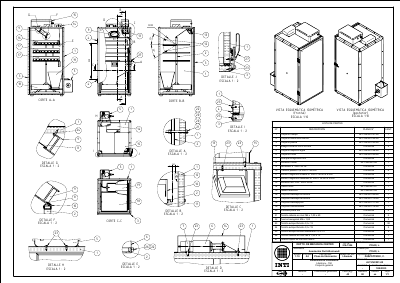00</a>

*Conjunto general (ALT-INC001-00).*

  <a href="https://github.com/Pablomonte/LibreIncu-150/blob/LibreIncu-150/HardWare/Mecanica/ALT-INC001-01-00.pdf" title="ALT-INC001-01-00" style="text-align:center; font-size:0.7rem;">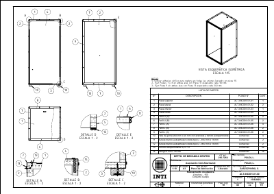01-00</a>
  <a href="https://github.com/Pablomonte/LibreIncu-150/blob/LibreIncu-150/HardWare/Mecanica/ALT-INC001-01-01.pdf" title="ALT-INC001-01-01" style="text-align:center; font-size:0.7rem;">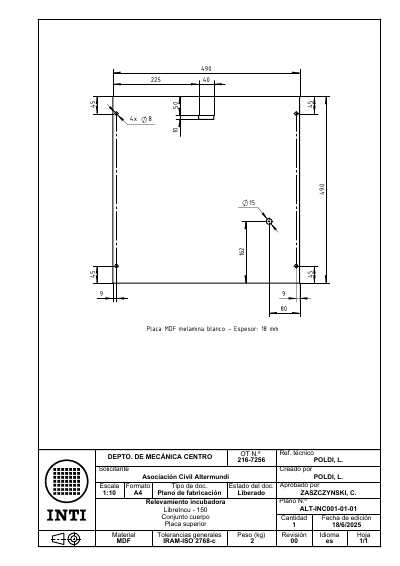01-01</a>
  <a href="https://github.com/Pablomonte/LibreIncu-150/blob/LibreIncu-150/HardWare/Mecanica/ALT-INC001-01-02.pdf" title="ALT-INC001-01-02" style="text-align:center; font-size:0.7rem;">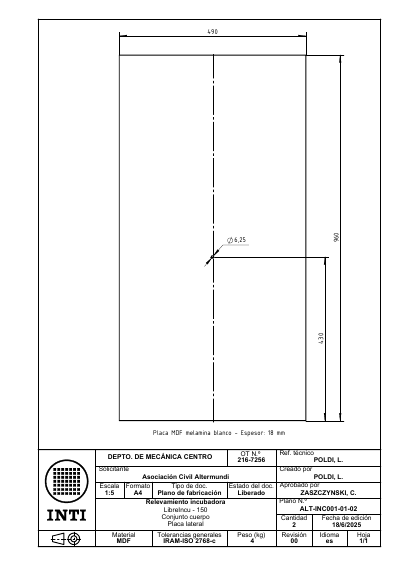01-02</a>
  <a href="https://github.com/Pablomonte/LibreIncu-150/blob/LibreIncu-150/HardWare/Mecanica/ALT-INC001-01-03.pdf" title="ALT-INC001-01-03" style="text-align:center; font-size:0.7rem;">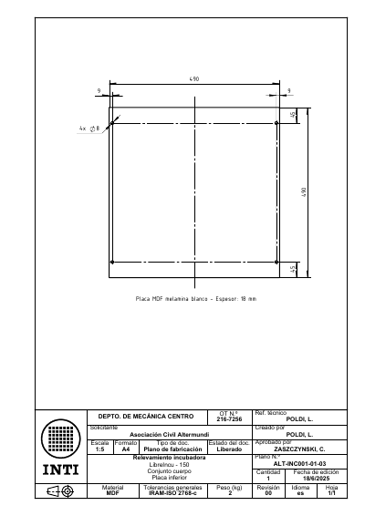01-03</a>
  <a href="https://github.com/Pablomonte/LibreIncu-150/blob/LibreIncu-150/HardWare/Mecanica/ALT-INC001-01-04.pdf" title="ALT-INC001-01-04" style="text-align:center; font-size:0.7rem;">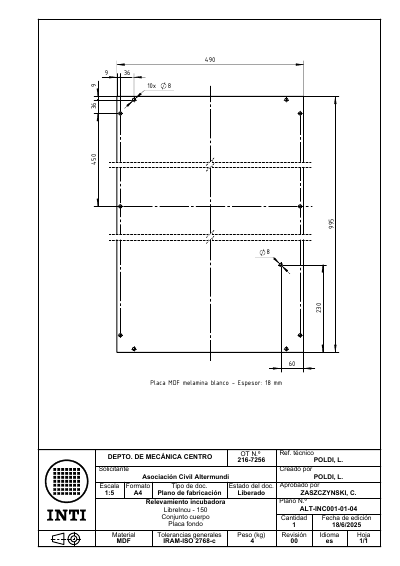01-04</a>
  <a href="https://github.com/Pablomonte/LibreIncu-150/blob/LibreIncu-150/HardWare/Mecanica/ALT-INC001-01-05.pdf" title="ALT-INC001-01-05" style="text-align:center; font-size:0.7rem;">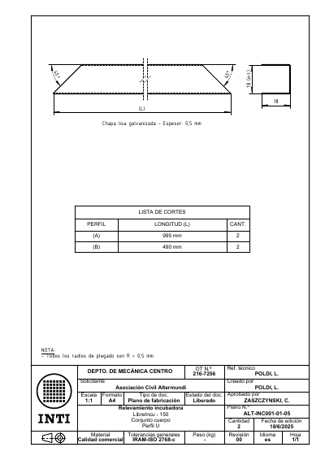01-05</a>
  <a href="https://github.com/Pablomonte/LibreIncu-150/blob/LibreIncu-150/HardWare/Mecanica/ALT-INC001-01-06.pdf" title="ALT-INC001-01-06" style="text-align:center; font-size:0.7rem;">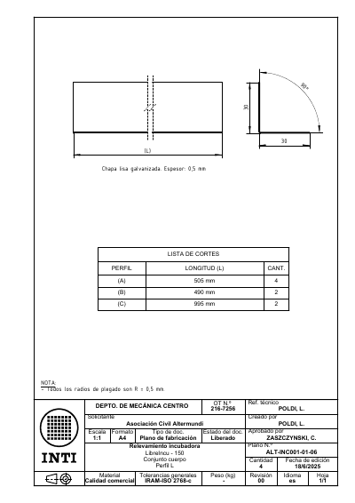01-06</a>

*Cuerpo (ALT-INC001-01-00 a 01-06).*

  <a href="https://github.com/Pablomonte/LibreIncu-150/blob/LibreIncu-150/HardWare/Mecanica/ALT-INC001-02-00.pdf" title="ALT-INC001-02-00" style="text-align:center; font-size:0.7rem;">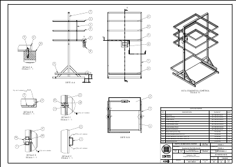02-00</a>
  <a href="https://github.com/Pablomonte/LibreIncu-150/blob/LibreIncu-150/HardWare/Mecanica/ALT-INC001-02-01.pdf" title="ALT-INC001-02-01" style="text-align:center; font-size:0.7rem;">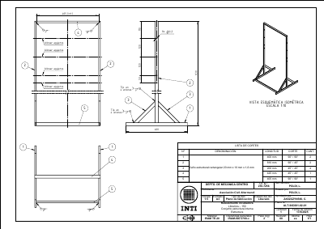02-01</a>
  <a href="https://github.com/Pablomonte/LibreIncu-150/blob/LibreIncu-150/HardWare/Mecanica/ALT-INC001-02-02.pdf" title="ALT-INC001-02-02" style="text-align:center; font-size:0.7rem;">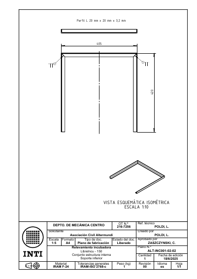02-02</a>
  <a href="https://github.com/Pablomonte/LibreIncu-150/blob/LibreIncu-150/HardWare/Mecanica/ALT-INC001-02-03.pdf" title="ALT-INC001-02-03" style="text-align:center; font-size:0.7rem;">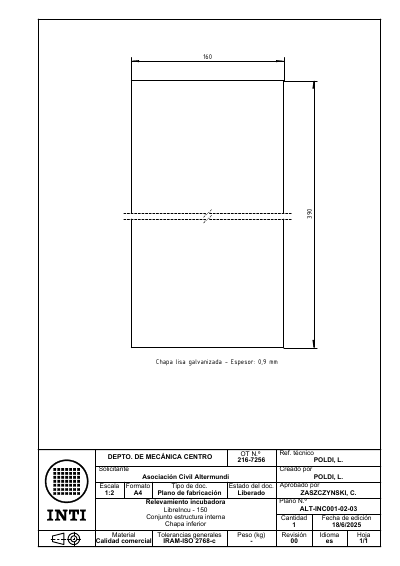02-03</a>
  <a href="https://github.com/Pablomonte/LibreIncu-150/blob/LibreIncu-150/HardWare/Mecanica/ALT-INC001-02-04.pdf" title="ALT-INC001-02-04" style="text-align:center; font-size:0.7rem;">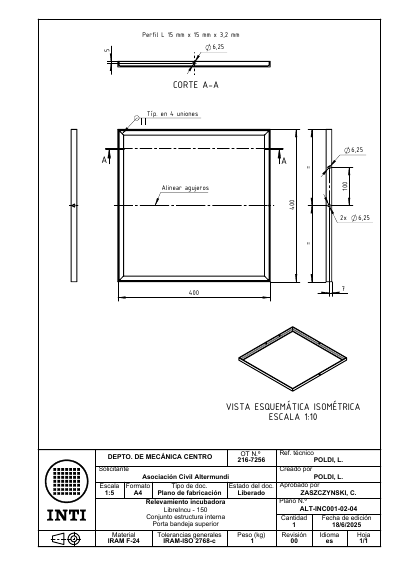02-04</a>
  <a href="https://github.com/Pablomonte/LibreIncu-150/blob/LibreIncu-150/HardWare/Mecanica/ALT-INC001-02-05.pdf" title="ALT-INC001-02-05" style="text-align:center; font-size:0.7rem;">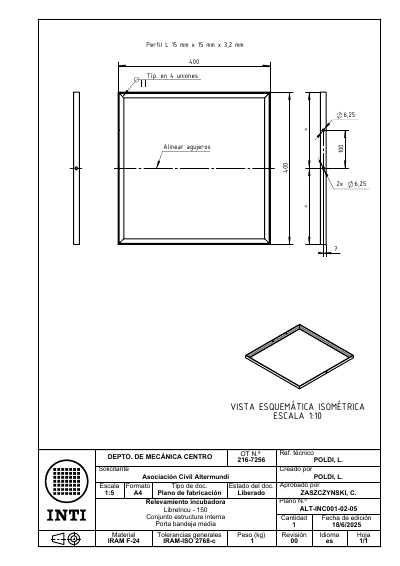02-05</a>
  <a href="https://github.com/Pablomonte/LibreIncu-150/blob/LibreIncu-150/HardWare/Mecanica/ALT-INC001-02-06.pdf" title="ALT-INC001-02-06" style="text-align:center; font-size:0.7rem;">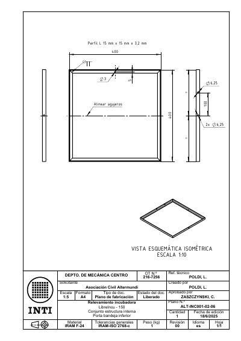02-06</a>
  <a href="https://github.com/Pablomonte/LibreIncu-150/blob/LibreIncu-150/HardWare/Mecanica/ALT-INC001-02-07.pdf" title="ALT-INC001-02-07" style="text-align:center; font-size:0.7rem;">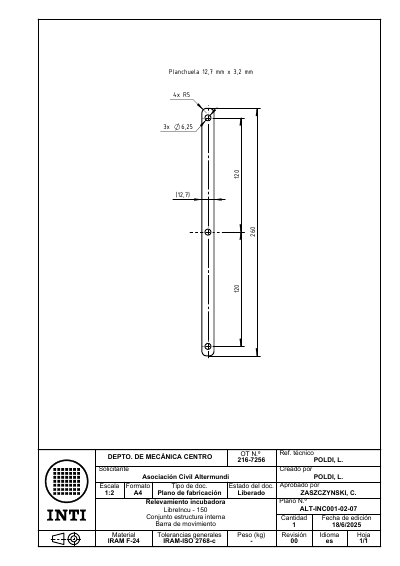02-07</a>

*Estructura interna (ALT-INC001-02-00 a 02-07).*

  <a href="https://github.com/Pablomonte/LibreIncu-150/blob/LibreIncu-150/HardWare/Mecanica/ALT-INC001-03-00.pdf" title="ALT-INC001-03-00" style="text-align:center; font-size:0.7rem;">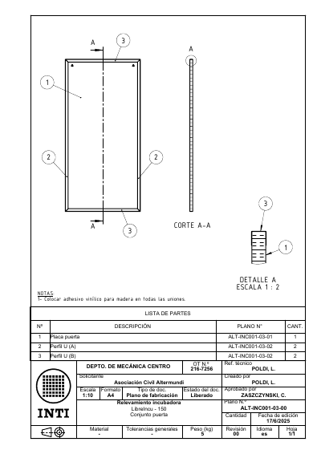03-00</a>
  <a href="https://github.com/Pablomonte/LibreIncu-150/blob/LibreIncu-150/HardWare/Mecanica/ALT-INC001-03-01.pdf" title="ALT-INC001-03-01" style="text-align:center; font-size:0.7rem;">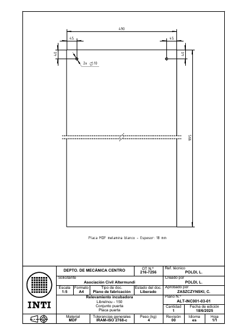03-01</a>
  <a href="https://github.com/Pablomonte/LibreIncu-150/blob/LibreIncu-150/HardWare/Mecanica/ALT-INC001-03-02.pdf" title="ALT-INC001-03-02" style="text-align:center; font-size:0.7rem;">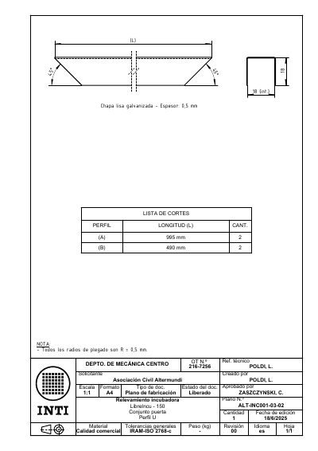03-02</a>

*Puerta (ALT-INC001-03-00 a 03-02).*

  <a href="https://github.com/Pablomonte/LibreIncu-150/blob/LibreIncu-150/HardWare/Mecanica/ALT-INC001-09-00.pdf" title="ALT-INC001-09-00" style="text-align:center; font-size:0.7rem;">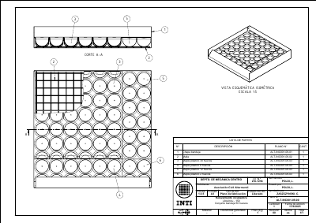09-00</a>
  <a href="https://github.com/Pablomonte/LibreIncu-150/blob/LibreIncu-150/HardWare/Mecanica/ALT-INC001-09-01.pdf" title="ALT-INC001-09-01" style="text-align:center; font-size:0.7rem;">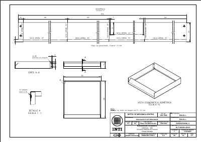09-01</a>
  <a href="https://github.com/Pablomonte/LibreIncu-150/blob/LibreIncu-150/HardWare/Mecanica/ALT-INC001-09-02.pdf" title="ALT-INC001-09-02" style="text-align:center; font-size:0.7rem;">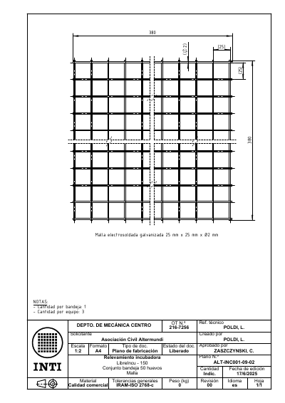09-02</a>
  <a href="https://github.com/Pablomonte/LibreIncu-150/blob/LibreIncu-150/HardWare/Mecanica/ALT-INC001-09-03.pdf" title="ALT-INC001-09-03" style="text-align:center; font-size:0.7rem;">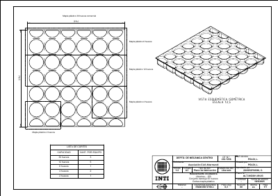09-03</a>
  <a href="https://github.com/Pablomonte/LibreIncu-150/blob/LibreIncu-150/HardWare/Mecanica/ALT-INC001-10-00.pdf" title="ALT-INC001-10-00" style="text-align:center; font-size:0.7rem;">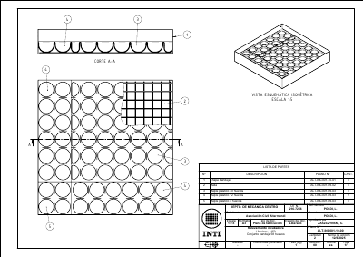10-00</a>
  <a href="https://github.com/Pablomonte/LibreIncu-150/blob/LibreIncu-150/HardWare/Mecanica/ALT-INC001-10-01.pdf" title="ALT-INC001-10-01" style="text-align:center; font-size:0.7rem;">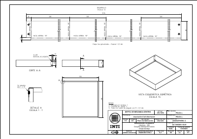10-01</a>
  <a href="https://github.com/Pablomonte/LibreIncu-150/blob/LibreIncu-150/HardWare/Mecanica/ALT-INC001-11-00.pdf" title="ALT-INC001-11-00" style="text-align:center; font-size:0.7rem;">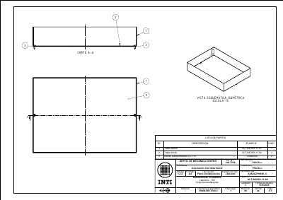11-00</a>
  <a href="https://github.com/Pablomonte/LibreIncu-150/blob/LibreIncu-150/HardWare/Mecanica/ALT-INC001-11-01.pdf" title="ALT-INC001-11-01" style="text-align:center; font-size:0.7rem;">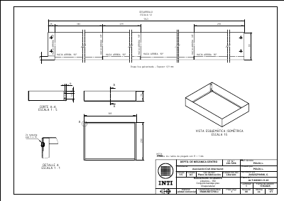11-01</a>
  <a href="https://github.com/Pablomonte/LibreIncu-150/blob/LibreIncu-150/HardWare/Mecanica/ALT-INC001-11-02.pdf" title="ALT-INC001-11-02" style="text-align:center; font-size:0.7rem;">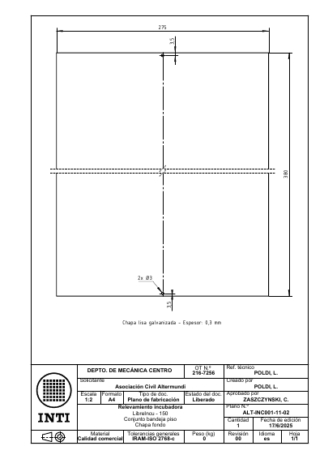11-02</a>

*Bandejas y bandeja piso (ALT-INC001-09-00 a 11-02).*

  <a href="https://github.com/Pablomonte/LibreIncu-150/blob/LibreIncu-150/HardWare/Mecanica/ALT-INC001-12-00.pdf" title="ALT-INC001-12-00" style="text-align:center; font-size:0.7rem;">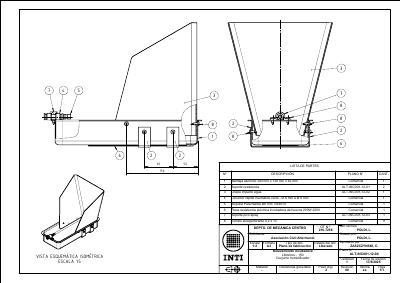12-00</a>
  <a href="https://github.com/Pablomonte/LibreIncu-150/blob/LibreIncu-150/HardWare/Mecanica/ALT-INC001-12-01.pdf" title="ALT-INC001-12-01" style="text-align:center; font-size:0.7rem;">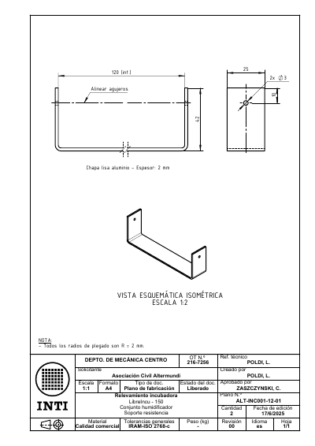12-01</a>
  <a href="https://github.com/Pablomonte/LibreIncu-150/blob/LibreIncu-150/HardWare/Mecanica/ALT-INC001-12-02.pdf" title="ALT-INC001-12-02" style="text-align:center; font-size:0.7rem;">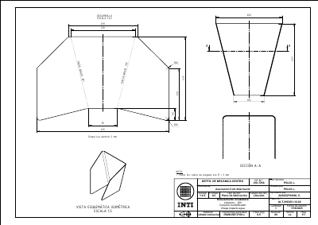12-02</a>
  <a href="https://github.com/Pablomonte/LibreIncu-150/blob/LibreIncu-150/HardWare/Mecanica/ALT-INC001-12-03.pdf" title="ALT-INC001-12-03" style="text-align:center; font-size:0.7rem;">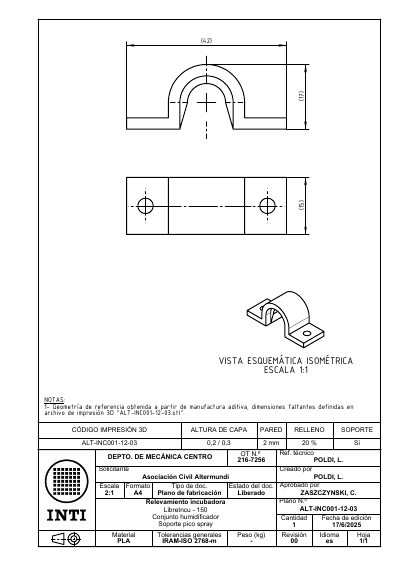12-03</a>

*Conjunto humidificador (ALT-INC001-12-00 a 12-03).*

## Archivos de fabricación

| Archivo | Pieza |
|---|---|
| [Deflector_Aire.dxf](cad/Deflector_Aire.dxf) | Desarrollo del deflector |
| [contraplaca_desarrollo.dxf](cad/contraplaca_desarrollo.dxf) | Desarrollo de la contraplaca |
| [carro_portatuercas_corredera-Body.dxf](cad/carro_portatuercas_corredera-Body.dxf) | Desarrollo del carro |
| [chapa_ranurada_bandeja.dxf](cad/chapa_ranurada_bandeja.dxf) | Chapa ranurada de la bandeja |
| [LibreIncu_Rediseno_Despiece.FCStd](https://github.com/Pablomonte/LibreIncu-150/blob/LibreIncu-150/fuentes/LibreIncu_Rediseno_Despiece.FCStd) | Modelo 3D de referencia de la v3 (FreeCAD) |

Los STEP del modelo están en [Vista 3D](vista-3d.md#descargas).
