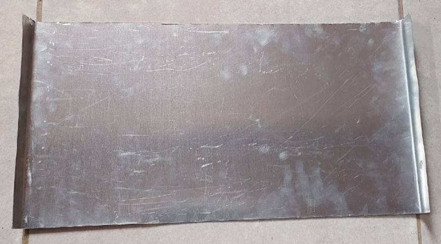
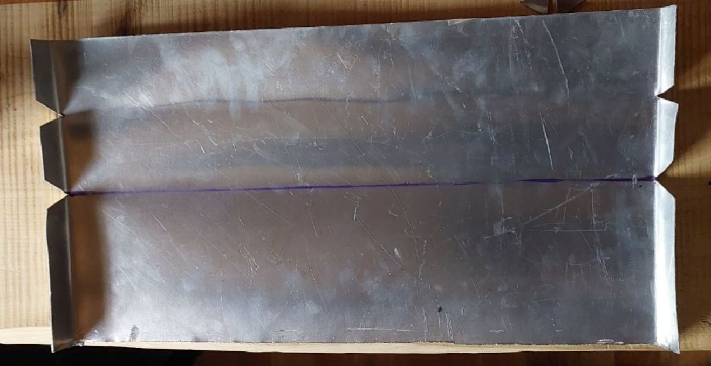
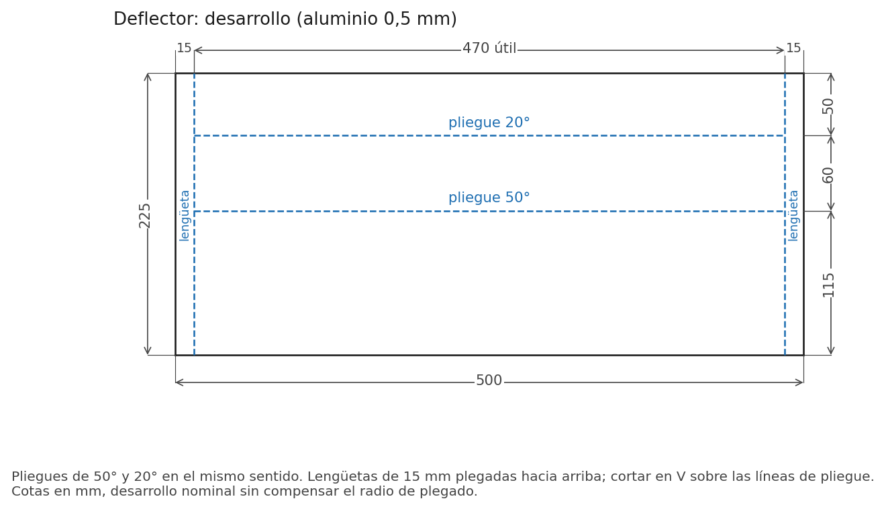
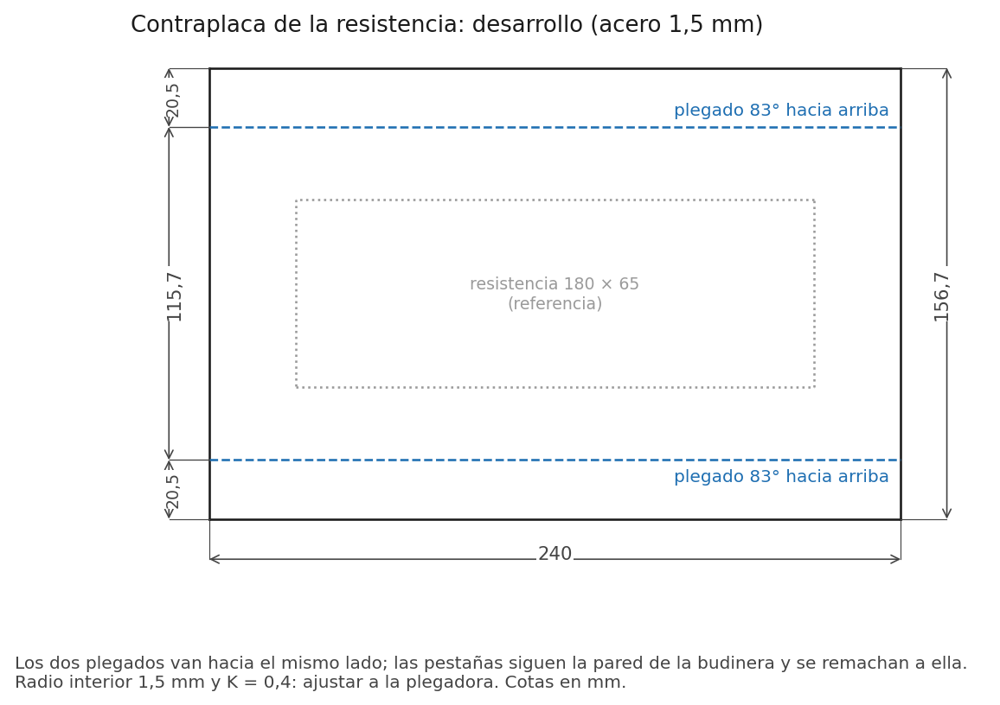
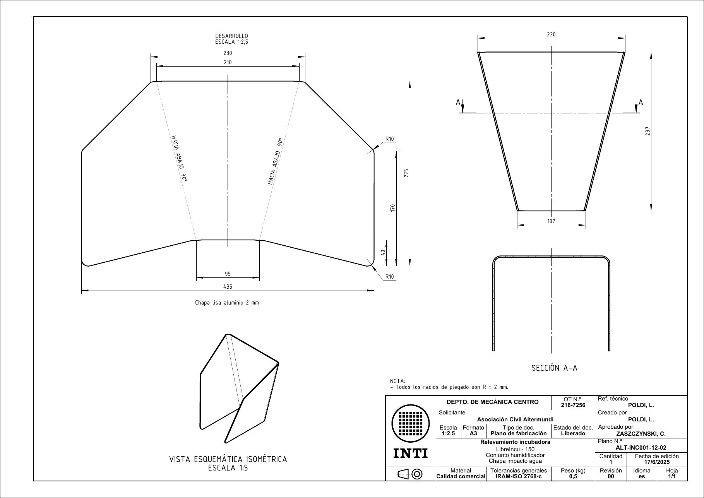
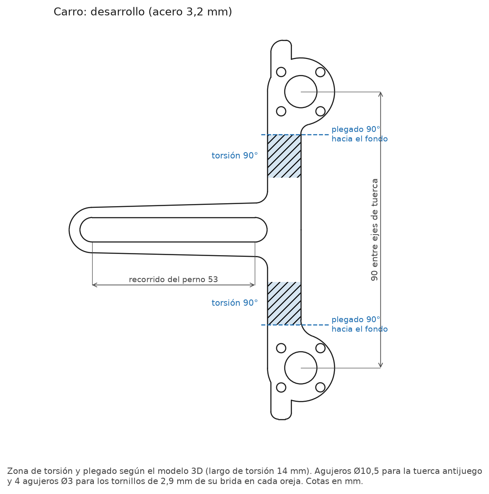

# Compra y corte

La lista completa de materiales, con cantidades por incubadora, precios y enlaces, está en el [inventario](inventario.md). Esta página reúne las piezas que hay que cortar o plegar.

!!! note "Compras"
    Elegir el tamaño de cada pack según la cantidad total a fabricar. Comprar con tiempo los componentes importados (sensor BME280, PCB Olivia).

## Mueble

Placas de MDF melamina blanco de 18 mm, según los planos ALT-INC001-01 y ALT-INC001-03 del INTI ([carpeta de planos](https://github.com/Pablomonte/LibreIncu-150/tree/LibreIncu-150/HardWare/Mecanica)).

| Pieza | Cantidad | Medida (mm) | Plano |
|---|---|---|---|
| Placa superior | 1 | 490 × 490 | ALT-INC001-01-01 |
| Placa inferior | 1 | 490 × 490 | ALT-INC001-01-03 |
| Placa lateral | 2 | 960 × 490 | ALT-INC001-01-02 |
| Placa fondo | 1 | 995 × 490 | ALT-INC001-01-04 |
| Placa puerta | 1 | 995 × 490 | ALT-INC001-03-01 |

Los perfiles U y L de chapa galvanizada de 0,5 mm del cuerpo y la puerta se cortan y pliegan según los planos ALT-INC001-01-05, 01-06 y 03-02.

## Chapas y perfiles

| Pieza | Cantidad | Material | Medida de corte (mm) | Ver |
|---|---|---|---|---|
| Deflector | 1 | Aluminio 0,5 mm | 500 × 225 | [Deflector](#deflector) |
| Contraplaca de la resistencia | 1 | Acero 1,5 mm | 240 × 156,7 | [Contraplaca](#contraplaca) |
| Chapa de impacto del agua | 1 | Aluminio 2 mm | 435 × 275 | [Chapa de impacto](#chapa-de-impacto) |
| Carro del husillo | 1 | Acero 3,2 mm | 74,6 × 123,5, según el [desarrollo](cad/carro_portatuercas_corredera-Body.dxf) | [Carro](#carro) |
| Chapa soporte del ventilador | 1 | Chapa 0,5 mm | 464 × 227 | — |
| Soportes de la bandeja nacedora | 2 | Perfil L 20 × 20 × 3,2 | 420 | ALT-INC001-02-02, partido en dos |
| Perfiles L de la budinera | 2 | Perfil L 20 × 20 × 2 | 470 | [Fuente de calor](montaje-mecanico.md#fuente-de-calor) |
| Ejes de bandeja | 3 | Barra de acero Ø8 | ≈ 490 | Medir en la unidad |
| Varilla de vínculo | 1 | Planchuela 20 × 3,2 | 260 | 3 agujeros Ø8 |

## Deflector

  
  

*Figuras 2 y 3. Chapa del deflector y deflector plegado.*

{ width=640 }

*Figura 4. Desarrollo del deflector.*

| Parámetro del desarrollo | Medida |
|---|---|
| Espesor de chapa | 0,5 mm |
| Largo del desarrollo | 225 mm |
| Ancho útil | 470 mm |
| Pestañas laterales | 15 mm por lado |
| Ancho total, con pestañas | 500 mm |
| Paños | 115 + 60 + 50 mm |
| Líneas de pliegue desde un extremo | 115 y 175 mm |
| Pliegues | 50° y 20°, en el mismo sentido |

1. Cortar chapa de aluminio de 0,5 mm de **500 × 225 mm**: deja **470 mm de ancho útil** y pestañas laterales de **15 mm por lado**. El desarrollo está en [`Deflector_Aire.dxf`](cad/Deflector_Aire.dxf).
2. Marcar los pliegues a **115 mm** y **175 mm** desde un extremo: forman paños de 115, 60 y 50 mm.
3. Cortar en V las pestañas sobre las líneas de pliegue.
4. Plegar **50°** en la línea de 115 mm y **20°** en la de 175 mm, en el mismo sentido. Con el paño de 115 mm inclinado 20° hacia abajo, el paño de 50 mm queda vertical.
5. Plegar las seis pestañas de 15 mm hacia arriba y desbarbar.

## Contraplaca

La contraplaca aprieta la resistencia contra el fondo de la budinera. Es una U con las pestañas hacia arriba, que se remachan a los costados de la budinera.

| Parámetro | Medida |
|---|---|
| Material | Acero 1,5 mm |
| Desarrollo | 240 × 156,7 mm |
| Líneas de plegado | 2, paralelas al lado de 240 mm, a 20,5 mm de cada borde |
| Ancho entre plegados | 115,7 mm |
| Ángulo de plegado | 83° hacia arriba, para seguir la pared inclinada de la budinera |

{ width=560 }

*Figura 5. Desarrollo de la contraplaca.*

1. Cortar la chapa de **240 × 156,7 mm**. El desarrollo está en [`contraplaca_desarrollo.dxf`](cad/contraplaca_desarrollo.dxf).
2. Marcar las líneas de plegado a **20,5 mm** de cada borde largo.
3. Plegar las dos pestañas **83°** hacia el mismo lado.
4. Presentar la contraplaca bajo la budinera: las pestañas deben apoyar en las paredes.

## Chapa de impacto

{ width=640 }

*Figura 6. Chapa de impacto del agua, plano ALT-INC001-12-02 del INTI.*

1. Cortar chapa de aluminio de **2 mm** según el desarrollo del plano: **435 × 275 mm**, respaldo trapezoidal de 95 mm abajo y 210 mm arriba.
2. Redondear las esquinas inferiores con radio de 10 mm.
3. Plegar **90° hacia abajo** las dos alas sobre las líneas indicadas, con radio de 2 mm.
4. Verificar la sección: 220 mm arriba, 102 mm abajo y 237 mm de alto.

## Carro

El carro usa la chapa original de 3,2 mm, sin cambiar sus medidas ([`carro_portatuercas_corredera-Body.dxf`](cad/carro_portatuercas_corredera-Body.dxf)). Lleva una ranura horizontal para el perno de la bandeja y dos orejas para las mitades de la tuerca antijuego.

{ width=420 }

*Figura 7. Desarrollo del carro.*

1. Cortar la chapa según el desarrollo.
2. Torcer **90°** el cuello de cada oreja sobre el eje de la oreja.
3. Plegar cada oreja **90° hacia el fondo**. En planta, el eje de las orejas queda en el plano de la ranura.

La torsión se hace con una plantilla, sobre los 14 mm marcados en el desarrollo.
