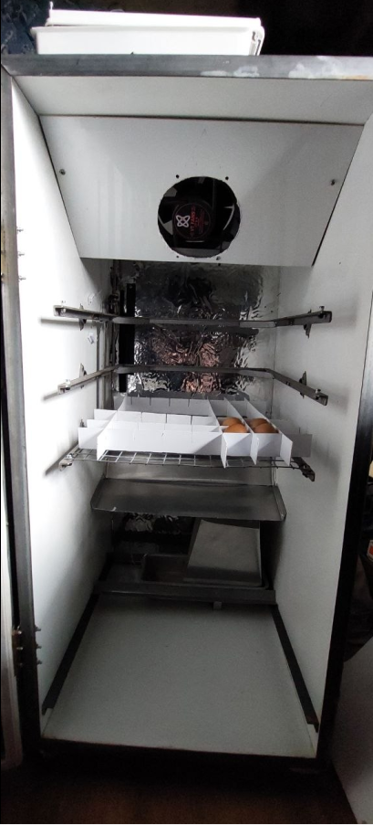

# Manual de fabricación y montaje - LibreIncu 150 v3

Este manual describe cómo fabricar y montar la incubadora LibreIncu 150 v3, un equipo automatizado para incubar huevos con control de temperatura, humedad y rotación de bandejas.

[Descargar manual PDF](manual_libreincu_150.pdf){ .md-button .md-button--primary }

!!! warning "Versión en preparación"
    El PDF todavía corresponde a la v1. Se regenera con el texto de la v3 cuando el manual esté completo.

{ width=300 }

*Figura 1. Interior del equipo.*

## Cómo usar este manual

Las páginas siguen el orden de fabricación:

| Etapa | Página |
|---|---|
| Preparar el trabajo y verificar medidas | [Antes de fabricar](antes-de-fabricar.md) |
| Comprar materiales, cortar y plegar las piezas | [Compra y corte](compra-y-corte.md) |
| Controlar que estén todas las piezas | [Inventario](inventario.md) |
| Mueble, bandejas, rotación, deflector, fuente de calor y humidificación | [Montaje mecánico](montaje-mecanico.md) |
| Tablero, placa Olivia, sensores y actuadores | [Instalación eléctrica](instalacion-electrica.md) |
| Primer encendido y pruebas | [Puesta en marcha](puesta-en-marcha.md) |

Los recuadros **Pendiente** marcan datos que todavía hay que medir o confirmar en la unidad real antes de fabricar en serie.

## Qué cambia respecto de la v1

- **Deflector:** pliegues de 50° y 20°; el paño superior queda vertical, a 60 mm del fondo, y el punto más bajo a 300 mm del piso.
- **Fuente de calor:** la resistencia se aprieta contra el fondo de la budinera con una contraplaca de acero. La budinera se remacha a dos perfiles L que apoyan en los soportes de la bandeja nacedora. Se agrega un fusible térmico de 175 °C en serie con la resistencia.
- **Rotación:** carro de chapa con las orejas torcidas 90°; los sensores reed dan la posición y los finales de carrera V-156-1C25 cortan el motor por seguridad.
- **Humidificación:** chapa de impacto del agua según el plano ALT-INC001-12-02 del INTI.

## Dimensiones

| Parámetro | Medida |
|---|---|
| Ancho interno | 470 mm |
| Profundidad interna | 500 mm |
| Alto interno | 970 mm |
| Bandejas | 400 × 400 mm |
| Ejes de bandeja, desde el techo | 255, 375 y 495 mm |
| Separación vertical entre ejes | 120 mm |
| Separación entre bandeja pivotante y pared | 30 mm |
| Soportes de la bandeja nacedora, desde el piso | 55 mm |
| Punto más bajo del deflector, desde el piso | 300 mm |
| Paño vertical del deflector, desde el fondo | 60 mm |
| Inclinación del paño principal del deflector | 20° hacia abajo |
| Paños del deflector | 115, 60 y 50 mm |
| Pliegues del deflector | 50° y 20° |
