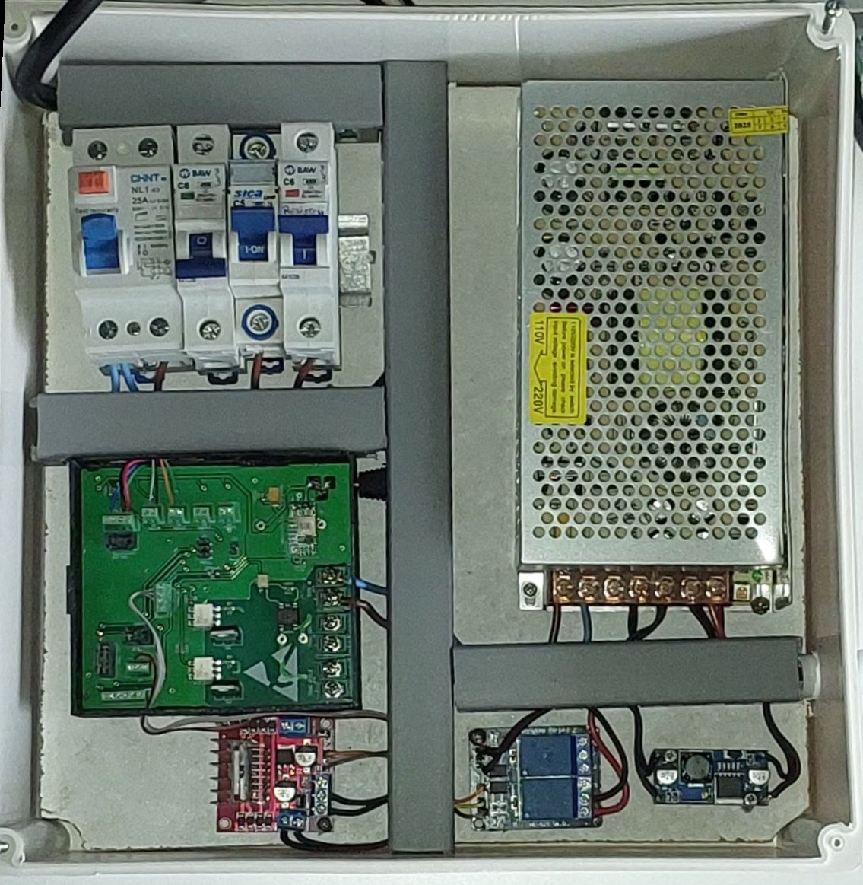
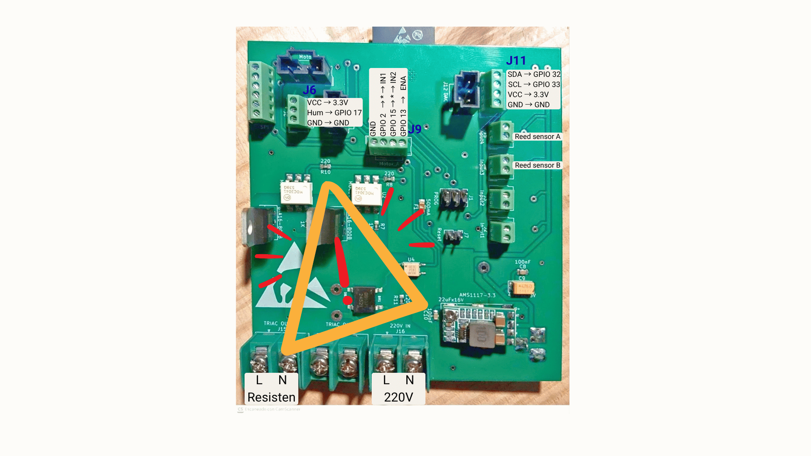
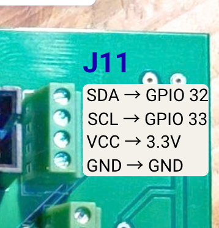
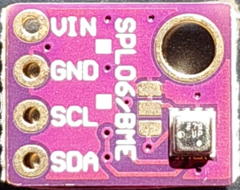
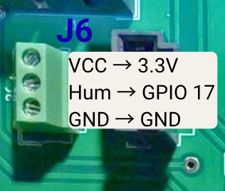
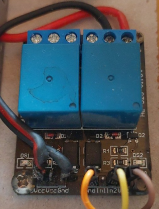
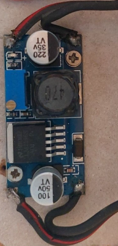
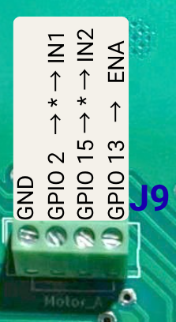
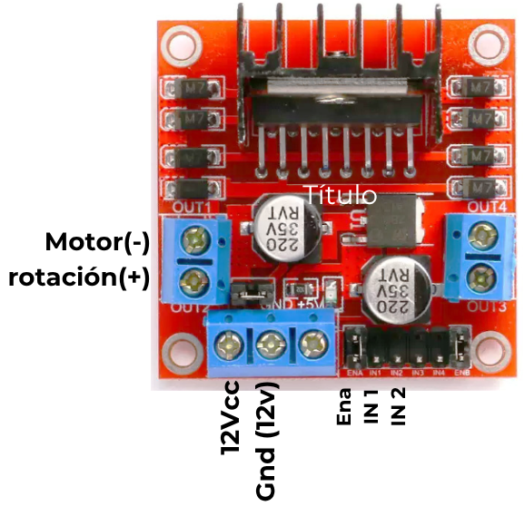
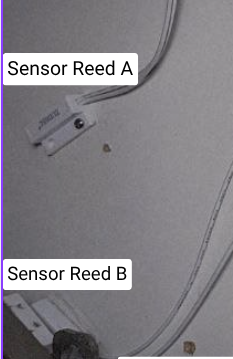

# Instalación eléctrica

Trabajar siempre sin tensión. El equipo se conecta a la red recién en la [puesta en marcha](puesta-en-marcha.md).

## Tablero

{ width=500 }

*Figura 9. Tablero eléctrico del equipo.*

| Componente | Descripción |
|---|---|
| Protecciones | Disyuntor diferencial e interruptores termomagnéticos. |
| Alimentación | Fuente de 220 V CA a 12 V CC y step-down de 12 V CC a 5 V CC. |
| Placa Olivia Control | ESP32 con WiFi; salida TRIAC para la resistencia de 200 W a 220 V CA; comunicación I2C con el BME280; entradas para los sensores de posición de las bandejas y salidas para puente H y relés. |
| Módulo puente H | Control del motor de rotación. |
| Módulo de relés | Control de la bomba del humidificador. |

{ width=440 }

*Figura 10. Placa Olivia Control V2.*

## Placa Olivia

Montar la placa Olivia Control en el gabinete acoplado al tablero eléctrico, respetando la ubicación de las ranuras y los orificios para el cableado.

## Resistencia

La salida TRIAC de la placa (**GPIO 14**) alimenta la resistencia de 200 W.

- El fusible térmico KSD301 va **en serie** con la resistencia, en la misma budinera. Corta a 175 °C sin depender del firmware.
- La resistencia se conecta con un conector interlock macho a una toma de chasis en la carcasa, para poder sacar la budinera.
- Conectar a tierra la budinera y la contraplaca.

## Sensor BME280

**Conector J11 — I2C.**

  
  

*Figuras 11 y 12. J11 y sensor BME280.*

| Señal de J11 | PinOut ESP32|
|---|---|
| SDA | GPIO 32 |
| SCL | GPIO 33 |
| VCC | 3,3 V |
| GND | GND |

## Relé del humidificador

**Conector J6.** La alimentación de los relés del módulo, **JVCC**, se conecta a la salida de **5 V CC** del step-down.

  
  
  

*Figuras 13–15. J6, módulo de relés y step-down. La alimentación JVCC de los relés es de 5 V; Hum/GPIO 17 debe accionar el mismo canal cuya salida normalmente abierta conmuta la bomba.*

| Señal de J6 | PinOut ESP32 |
|---|---|
| VCC | 3,3 V |
| Hum | GPIO 17 |
| GND | GND |

Los contactos **NO —normalmente abiertos—** del relé se conectan como interruptor en uno de los cables de alimentación de la bomba de agua.

Conectar **Hum/GPIO 17 a la entrada IN1 o IN2 del canal elegido**. La bomba debe conectarse a la salida NO de **ese mismo relé**. Puede utilizarse cualquiera de los dos canales, siempre que la entrada de control y la salida de la bomba correspondan al mismo relé.

Conectar GND y VCC del módulo a las señales correspondientes de J6, conservando la alimentación JVCC de los relés a 5 V CC.

## Puente H de rotación

**Conector J9 — Motor A.** Retirar el jumper que normalmente puentea **ENA** en el módulo.

  
  

*Figuras 16 y 17. Señales de J9 y conexiones rotuladas del puente H; los asteriscos indican la interrupción mediante finales de carrera.*

| Señal de J9 | Conexión al puente H |
|---|---|
| GND | GND |
| GPIO 2 | IN1, pasando por el final de carrera A |
| GPIO 15 | IN2, pasando por el final de carrera B |
| GPIO 13 | ENA |

## Sensores reed

| Entrada | PinOut ESP32 | Sensor |
|---|---|---|
| Input4 | GPIO 35 | Reed A: posición superior |
| Input3 | GPIO 34 | Reed B: posición inferior |

{ width=280 }

*Figura 18. Sensores magnéticos de posición superior e inferior.*

## Finales de carrera

Los finales de carrera V-156-1C25 interrumpen las señales de mando del puente H:

- **Final de carrera A:** interrumpe el cable entre Motor A de Olivia, **GPIO 2**, y **IN1** del puente H.
- **Final de carrera B:** interrumpe el cable entre Motor A de Olivia, **GPIO 15**, y **IN2** del puente H.
