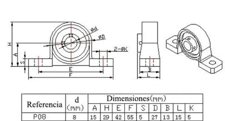
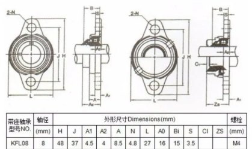
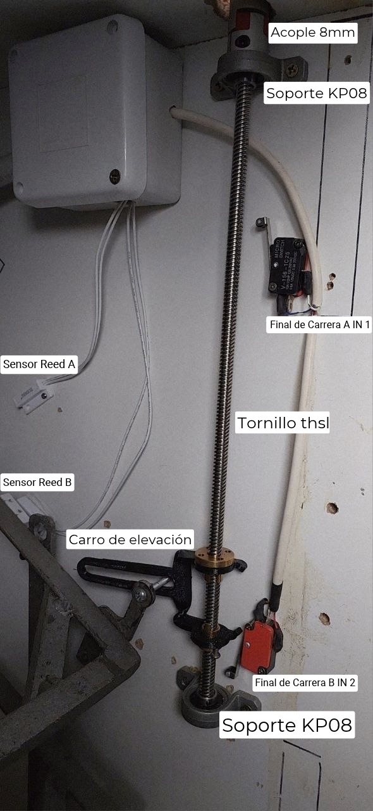
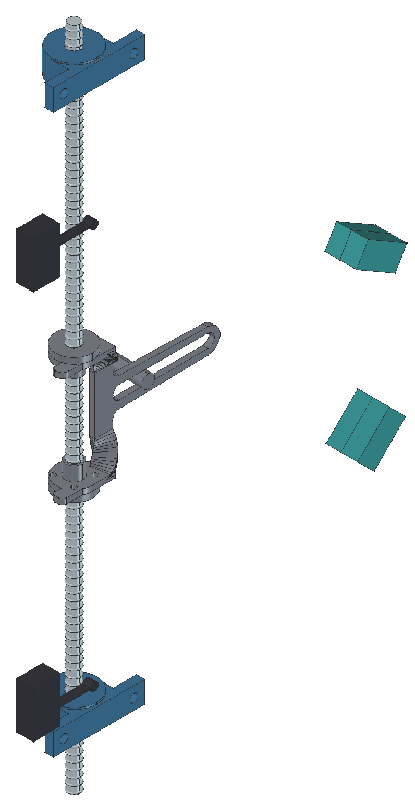
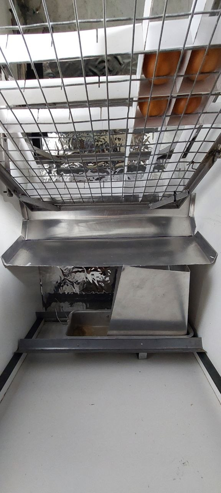
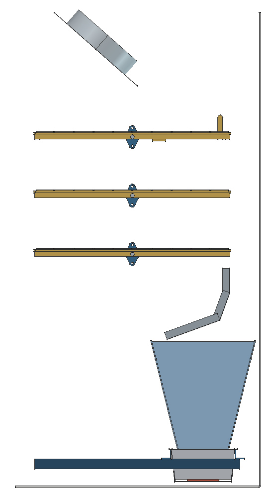
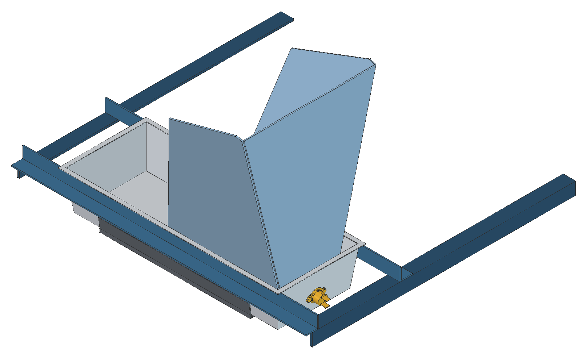
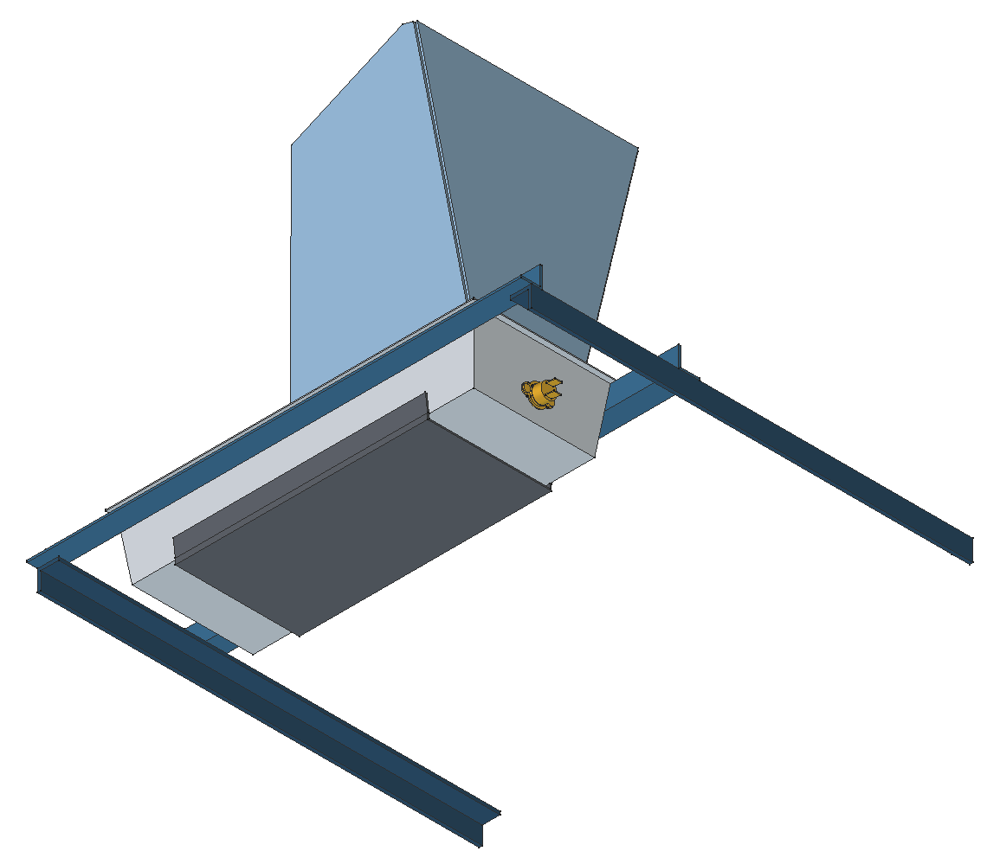

# Montaje mecánico

Las cotas de esta página se toman con el interior de la cámara como referencia: ancho desde un lateral, profundidad desde el fondo y altura desde el piso. El husillo va contra el lateral izquierdo; «del lado del husillo» indica ese lateral.

## Mueble

Armar el cuerpo según el plano ALT-INC001-01-00 y la puerta según el ALT-INC001-03-00 del INTI ([carpeta de planos](https://github.com/Pablomonte/LibreIncu-150/tree/LibreIncu-150/HardWare/Mecanica)).

- Unir las placas con tarugos de 8 × 40 mm y tornillos autoperforantes de 4,2 × 13 mm.
- Colocar los perfiles de chapa en los cantos, el burlete tipo D en el marco y las cuatro patas de goma.
- Montar la puerta con dos bisagras ficha de 63 mm y el cierre de tracción.

## Bandejas

Cada cuna lleva soldados dos muñones de barra Ø8, uno en el centro de cada brazo, casi en el borde inferior del ala. Cada muñón termina dentro de su KFL08, sin sobresalir hacia el lateral. Como los muñones no se pueden pasar con los soportes ya fijos, los KFL08 se colocan en la cuna antes de atornillarlos.

1. Colocar un KFL08 en cada muñón de la cuna.
2. Presentar la cuna y atornillar los dos soportes a los laterales, con el centro del eje a **260 mm del fondo** y a **255, 375 y 495 mm del techo**.
3. Colocar la varilla de vínculo en los pernos Ø8 de las tres cunas, soldados en el brazo del lado del husillo a 100 mm del eje, hacia el fondo.

!!! note "Plantilla"
    Los agujeros de los laterales se marcan con las plantillas de perforación, para que los seis soportes queden alineados. Cada lateral tiene una plantilla superior, que se apoya contra el techo y el fondo, y una inferior, que se apoya contra el piso y el fondo.

  
  

*Figuras 8 y 9. Soportes KP08 (husillo) y KFL08 (bandejas).*

## Rotación

{ width=380 }

*Figura 10. Disposición del mecanismo de rotación.*

### Husillo y motor

1. **Montar el carro en el husillo.**
    - Colocar las dos mitades de la tuerca antijuego, una en cada oreja del carro, y fijar cada brida con cuatro tornillos autorroscantes de 2,9 mm.
    - Enhebrar el carro sobre el husillo.
    - Ajustar la altura inicial, de la mitad del husillo hacia abajo.
2. **Montar los soportes KP08 y el motor.**
    - El husillo va a **15 mm del lateral izquierdo** y a **40 mm del fondo**, desde **10 mm del techo** hacia abajo.
    - Anclar el soporte KP08 superior al mueble y ajustar el husillo con los prisioneros del soporte, con una llave Allen de 1,5 mm. Dejar que sobresalga hacia arriba unos 12 mm.
    - Colocar y anclar el otro soporte KP08 al mueble.
    - Ajustar el acople de 8 mm al motor y al husillo.
    - Colocar el soporte del motor, cuidando que la separación entre los extremos de los ejes en el acople no supere 1 mm y que no queden apretados.

### Carro

{ width=180 }

*Figura 11. Carro, finales de carrera y reed en el modelo.*

El alma del carro queda paralela al lateral, en el plano del husillo, con la ranura horizontal. El perno del carro va soldado a una planchuela de 10 mm, en el brazo del lado del husillo de la cuna superior, 40 mm sobre el eje y 180 mm hacia el fondo. El perno corre por la ranura: al subir y bajar el carro, las bandejas giran.

1. Verificar que el carro suba y baje sin rozar el lateral.
2. Colocar el perno de la planchuela de la cuna superior en la ranura.

### Sensores y finales de carrera

| Elemento | Función | Ubicación |
|---|---|---|
| Reed A | Posición superior: el firmware detiene el motor. | Centro a 210 mm del fondo y 210 mm del techo, inclinado 30° bajando hacia la puerta. |
| Reed B | Posición inferior: el firmware detiene el motor. | Centro a 210 mm del fondo y 305 mm del techo, en línea con el eje de la bandeja superior. |
| Final de carrera A (superior) V-156-1C25 | Seguridad: corta el giro a la derecha si falla el reed A. | Rodillo a 40 mm del fondo y 110 mm del techo. |
| Final de carrera B (inferior) V-156-1C25 | Seguridad: corta el giro a la izquierda si falla el reed B. | Rodillo a 40 mm del fondo y 350 mm del techo. |

Los reed van contra el lateral del husillo, sobre tacos de 10 mm, del lado del fondo del eje de la bandeja superior. Su imán va pegado a la cara exterior del brazo del lado del husillo de la cuna superior, a 55 mm del eje hacia el fondo y con el canto en el borde superior del brazo.

Los finales de carrera van de plano contra el lateral, detrás del husillo, y los pisan las orejas del carro. En el modelo, el final A conmuta con la bandeja inclinada unos 24° y el B unos 32°. La plantilla marca el contorno de cada final de carrera, de cada reed y el centro del rodillo; sus agujeros se marcan con la pieza apoyada.

## Deflector

{ width=320 }

*Figura 12. Deflector instalado debajo de las bandejas.*

{ width=300 }

*Figura 13. Corte lateral del modelo, con el fondo a la derecha. El paño vertical del deflector queda a 60 mm del fondo y su borde más bajo a 300 mm del piso, sobre la chapa de impacto.*

El deflector se fabrica según [Compra y corte](compra-y-corte.md#deflector).

1. Ubicar el paño de 50 mm vertical, paralelo al fondo, a **60 mm del fondo**.
2. El paño de 115 mm baja 20° hacia la puerta. Su borde más bajo queda a **300 mm del piso**, justo por encima de la chapa de impacto del agua. El borde superior del paño vertical queda a 446 mm del piso.
3. Fijar las pestañas laterales a las paredes.
4. Girar las bandejas en todo su recorrido y verificar que la inferior no toque el deflector.

## Fuente de calor

La resistencia va debajo de la budinera, apretada contra su fondo por la contraplaca. La budinera se remacha a dos perfiles L que cruzan la cámara a lo ancho y apoyan en los soportes de la bandeja nacedora. Para limpiar la budinera se saca junto con los perfiles L.

  
  

*Figuras 14 y 15. Fuente de calor vista desde arriba y desde abajo: budinera, perfiles L, soportes de la nacedora, contraplaca (gris oscuro), fusible (amarillo) y chapa de impacto.*

| Altura desde el piso | Elemento |
|---|---|
| 8,5 mm | Cara inferior de la contraplaca |
| 14 mm | Base de la budinera |
| 55 mm | Cara superior de los soportes de la nacedora |
| 55 a 75 mm | Perfiles L de la budinera |
| 76 mm | Labio de la budinera |

1. **Soportes de la nacedora.** Fijar un perfil L de 20 × 20 × 3,2 mm en cada lateral, con el ala horizontal hacia adentro y su cara superior a **55 mm del piso**.
2. **Fusible térmico.** En la punta de la budinera del lado del husillo, hacer dos agujeros de 3,2 mm separados 23 mm, con el eje a unos 21 mm sobre la base. Remachar el fusible con la cara sensora contra la pared, con dos remaches pop de 3,2 × 8 mm.
3. **Resistencia.** Centrarla debajo de la base de la budinera, con los cables saliendo por los lados cortos.
4. **Contraplaca.** Colocarla debajo de la resistencia, con las pestañas contra las paredes largas de la budinera. Apretar y remachar las pestañas.
5. **Perfiles L.** Remachar el ala vertical de cada perfil a una pared larga de la budinera, debajo del labio, con el labio apoyado en el borde del ala.
6. **Colocación.** Apoyar las alas horizontales de los perfiles sobre los soportes de la nacedora, con el centro de la budinera a unos 115 mm del fondo.
7. **Conexión.** Conectar la resistencia, con el fusible en serie, al conector interlock macho. Enchufarlo a la toma de chasis de la carcasa.

## Humidificación

1. **Chapa de impacto.** Colocarla en la punta de la budinera del lado del husillo, con el respaldo hacia esa punta y las alas hacia el centro. Su borde superior queda a 298 mm del piso, debajo del deflector. Fijarla a la budinera con tornillos autoperforantes de 4,2 × 13 mm o con remaches pop.
2. **Aspersor.** Fijar la ménsula a la carcasa y montar la boquilla de 6 mm, apuntando a la chapa de impacto.
3. **Bomba y electroválvula.** Conectarlas entre sí y montarlas encima de la cámara, dentro de una caja estanca con un desagote en el punto más bajo para las pérdidas ocasionales. Unirlas a la boquilla con manguera de 10 mm y el acople rápido de 10 a 6 mm.
