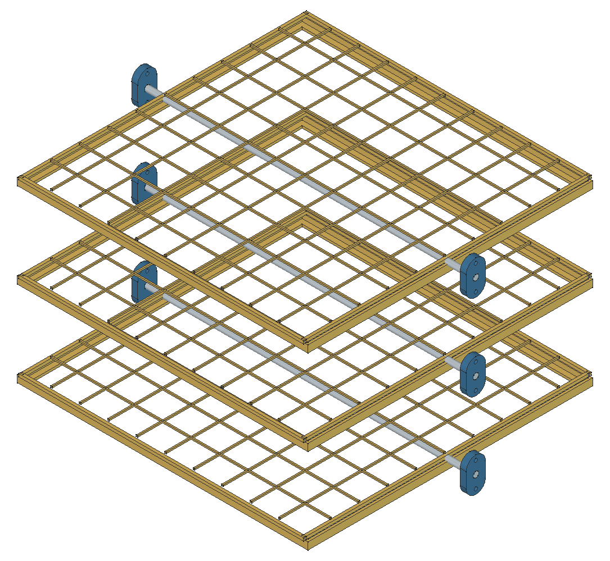
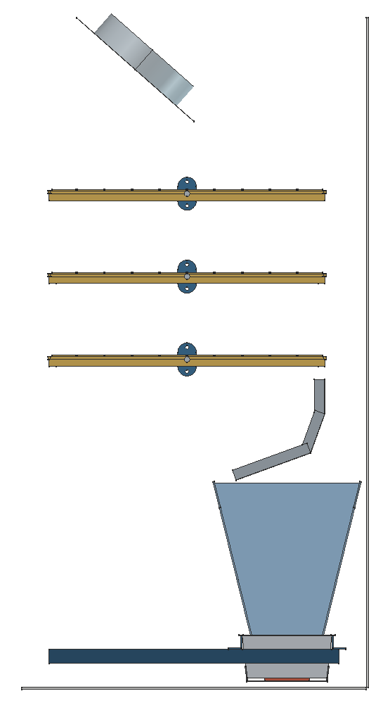
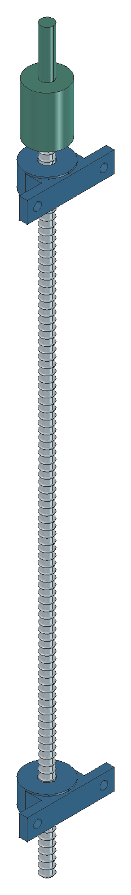
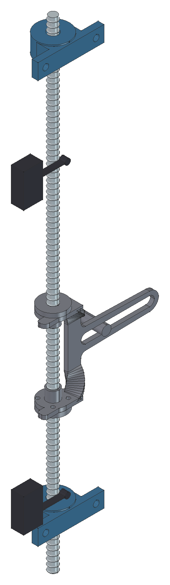
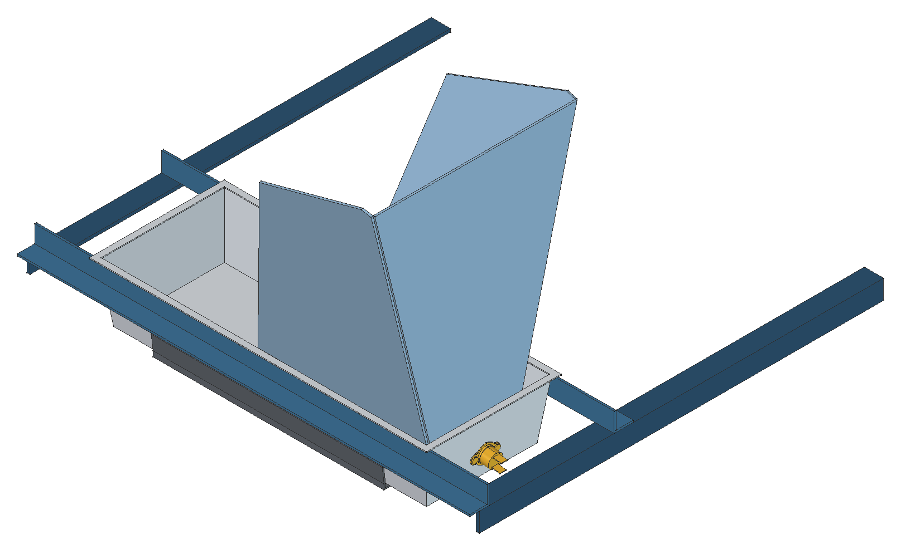
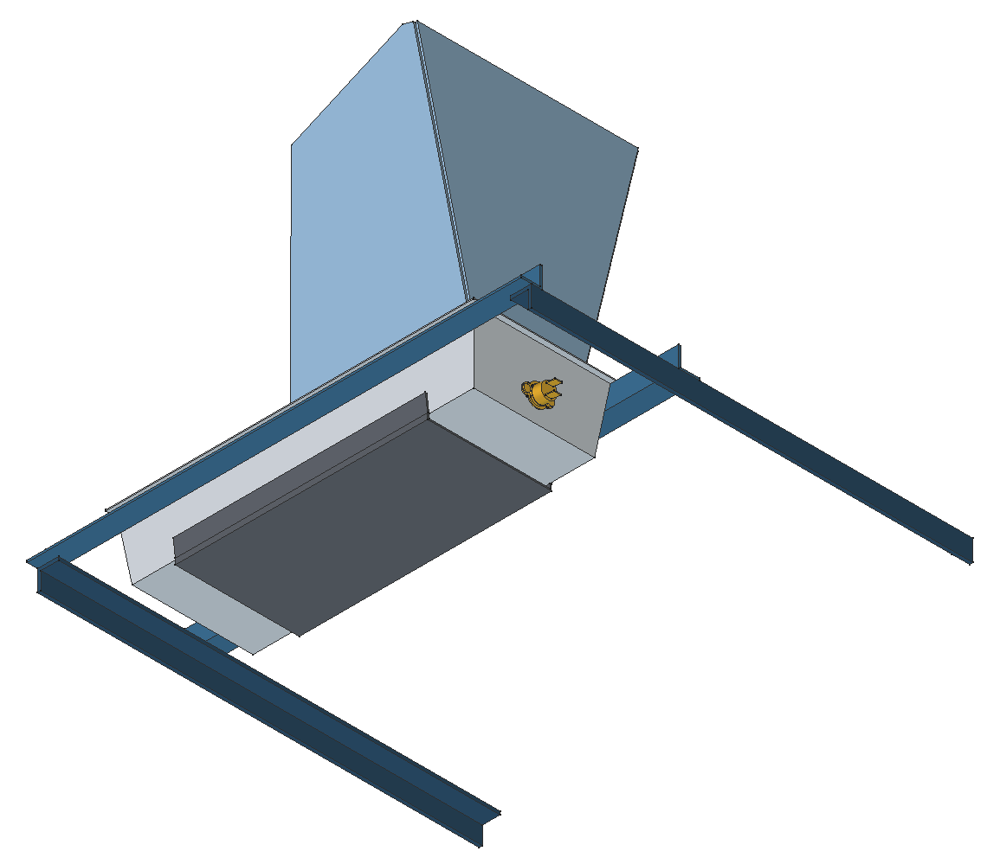

# Vista 3D

Vistas y archivos del modelo 3D de la v3 (`LibreIncu_Rediseno_Despiece.FCStd`).

{ width=640 }

*Bandejas, cunas, ejes y soportes KFL08.*

{ width=320 }

*Corte lateral: ventilador, bandejas, deflector y fuente de calor.*

  
  

*Husillo, KP08 y acople; carro y finales de carrera.*

  
  

*Fuente de calor desde arriba y desde abajo.*

## Descargas

| Archivo | Contenido |
|---|---|
| [LibreIncu_Rediseno_Despiece.step](cad/LibreIncu_Rediseno_Despiece.step) | Conjunto completo |
| [bandejas-y-soportes.step](cad/bandejas-y-soportes.step) | Bandejas, cunas, ejes y soportes |
| [husillo-kp08-acople.step](cad/husillo-kp08-acople.step) | Husillo, KP08 y acople |
| [carro-y-finales-de-carrera.step](cad/carro-y-finales-de-carrera.step) | Carro plegado y finales de carrera |
| [deflector.step](cad/deflector.step) | Deflector |
| [fuente-de-calor.step](cad/fuente-de-calor.step) | Fuente de calor y chapa de impacto |

Los desarrollos de chapa en DXF están en los [anexos](anexos.md#archivos-de-fabricacion).
